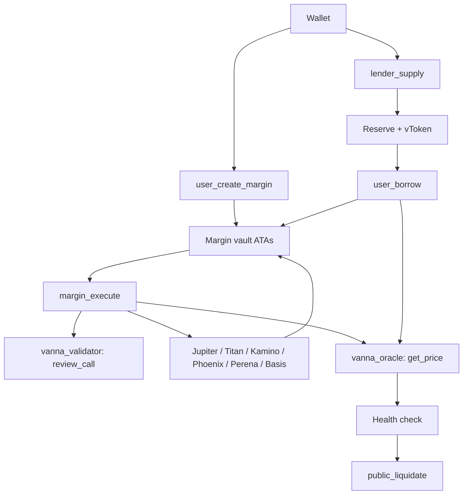

Solana splits code and state. Vanna's programs are executable at fixed IDs, and every pool, config and user account is a separate PDA they own.

## Three programs

| Program | Job |
|---|---|
| `vanna_credit_layer` (core) | Lending pools, margin accounts, borrowing, health checks, liquidation, and `margin_execute` |
| `vanna_oracle` | Values every holding: tokens from its **price book** (Kamino Scope first, Pyth as fallback, receipt tokens through their issuer's accounts), Phoenix positions from its **market book** |
| `vanna_validator` | Reviews every external call: which instruction, which accounts, which vaults it may spend from and pay into, and how much |

The core knows no price source and no external protocol. It asks the agents and accepts only their return data. Adding a protocol means adding rules to the validator (and, if needed, a reader to the oracle), then one admin registration. The core is not redeployed.

## Core accounts

| Component | Role |
|---|---|
| `ProtocolConfig` | Admin, treasury, operating mode, margin limits, the allowed-token list |
| `AssetConfig` | Per token: risk parameters, caps, its oracle. Also one per venue (Phoenix) |
| `Reserve` | Per pool: cash, borrows, rate curve, share mint |
| `MarginAccount` | One per wallet: its active debts and venues |
| `DebtPosition` | Borrow shares for one (margin, reserve) |
| `Integration` | One per whitelisted external program, naming its validator |

Earn never touches a margin account. A margin account never uses Earn vTokens as collateral unless the user redeems first and deposits the underlying.

See [Developer Architecture](/solana/developers/architecture) for the account graph and the remaining-accounts convention.
